# 📚 Zython Developer Documentation & Architecture Portal

Welcome to the internal engineering documentation and architectural reference for **Zython** — the high-performance Python runtime engineered from scratch in pure Zig.

---

## 🧭 Navigation & Document Index

| Document | Purpose | Key Topics Covered |
|---|---|---|
| [**1. Baseline Architecture (v0.1.0)**](file:///home/xagi/Desktop/zig_com/zython-/developer_doc/01_baseline_architecture_v0.1.0.md) | Initial Architecture & Discovery | • Recursive AST tree-walking interpreter • `fast_slots: [8]` CPU cache design • Peephole loop reductions ($O(1)$) • Pros, cons, bottlenecks & limitations |
| [**2. Phase 2 Architecture (v0.2.0)**](file:///home/xagi/Desktop/zig_com/zython-/developer_doc/02_current_architecture_v0.2.0.md) | Optimized Architecture & Bugfixes | • Monomorphic inline caching (MIC) • Expanded fast slots (32 locals, 16 attributes) • Zero-allocation method dispatch • Slicing, f-strings, exception matching • Initial benchmark baselines vs CPython 3.14 |
| [**3. Future Architecture & JIT Blueprint**](file:///home/xagi/Desktop/zig_com/zython-/developer_doc/03_future_architecture_v0.3.0_to_v0.5.0.md) | Blueprint to 50× – 100× Speedup | • Phase 3 Bytecode VM (**Delivered**) • Phase 4 Adaptive Specialization (**Delivered**) • Phase 5 Copy-and-Patch Native JIT Compiler (**Delivered**) • NaN-boxing 64-bit word value model |
| [**4. Phase 5 Architecture (v0.5.0)**](file:///home/xagi/Desktop/zig_com/zython-/developer_doc/04_phase5_copy_and_patch_jit_v0.5.0.md) | Native JIT Compiler & 55.2× Speedup | • Copy-and-Patch JIT compilation • Executable memory arena (`mmap/PROT_EXEC`) • Binary machine code stencils • Empirical 55.2× speedup on fib(26) |
| [**5. Phase 6 Architecture (v0.6.0)**](file:///home/xagi/Desktop/zig_com/zython-/developer_doc/05_phase6_bignums_decorators_and_context_managers_v0.6.0.md) | Bignums, Context Managers & Decorators | • Multi-limb arbitrary precision (`PyBigInt`) • `with EXPR as VAR:` context managers • `@decorator` syntax wrapping • 100% parity across all edge cases |
| [**6. Phase 7 Architecture (v0.7.0)**](file:///home/xagi/Desktop/zig_com/zython-/developer_doc/06_phase7_generators_coroutines_and_async_v0.7.0.md) | Stackless Generators & Async/Await | • Stackless `PyGenerator` & `yield` • Iteration protocol (`next()`, `__iter__()`) • `async def` & `await` expressions (`PyCoroutine`) • `asyncio.run()` event loop scheduler |
| [**7. Phase 8 Architecture (v0.8.0)**](file:///home/xagi/Desktop/zig_com/zython-/developer_doc/07_phase8_multithreading_and_threadpool_v0.8.0.md) | Native Multi-Threading & Concurrency | • Preemptive OS threads (`std.Thread.spawn`) • Lock, RLock, Semaphore, Event primitives • `ThreadPoolExecutor` & `as_completed` • GIL-free multi-core parallel execution |
| [**8. Phase 9 Architecture (v0.9.0)**](file:///home/xagi/Desktop/zig_com/zython-/developer_doc/08_phase9_c_extensions_and_ctypes_v0.9.0.md) | C-Extension FFI & ctypes Bridge | • Native `ctypes` (`CDLL`, `cdll`, `sizeof`, `byref`, `c_*`) • CPython C-API layer (`src/capi.zig`) • Dynamic `.so` module loading & `PyInit_<name>` • Bidirectional `Value` ↔ `PyObject*` conversion |
| [**9. Master Achievements & Bug Audit**](file:///home/xagi/Desktop/zig_com/zython-/developer_doc/achievements.md) | Comprehensive Audit & Fix Records | • BUG-01 through BUG-08 root causes & fixes • Phase 4 Quickening & PIC achievements • Phase 5 JIT compiler achievements & 55.2× speedup • Phase 6 Bignum, context manager & decorator audit • Phase 7 Generator & coroutine audit • Phase 8 Multi-threading & ThreadPool audit • Phase 9 C-Extension FFI & ctypes audit |
| [**10. Master Roadmap & Completion Matrix**](file:///home/xagi/Desktop/zig_com/zython-/developer_doc/roadmap.md) | Execution Plan & Milestones | • Phases 1 through 9 marked 100% COMPLETE • Phase 10 General Availability specification • Full language feature compatibility matrix |

---

## ⚡ Architecture Evolution Overview

```mermaid
flowchart LR
    subgraph Phase1 ["v0.1.0: Baseline AST (✅)"]
        A1["Source (.py)"] --> B1["Lexer / Parser"]
        B1 --> C1["AST Tree (*Expr)"]
        C1 --> D1["Tree-Walk Interpreter"]
        D1 --> E1["8-Slot Env Cache"]
    end

    subgraph Phase2 ["v0.2.0: Optimized AST & MIC (✅)"]
        A2["Source (.py)"] --> B2["F-String / Tuple Parser"]
        B2 --> C2["Annotated AST"]
        C2 --> D2["Monomorphic Inline Cache"]
        D2 --> E2["32 Fast Slots + 16 OOP Slots"]
        E2 --> F2["8 Bugs Resolved"]
    end

    subgraph Phase3 ["v0.3.0: Bytecode VM (✅)"]
        A3["Source (.py)"] --> B3["AST-to-Bytecode Compiler"]
        B3 --> C3["Packed 32-bit Instructions"]
        C3 --> D3["Linear Stack VM (16k stack)"]
        D3 --> E3["Direct CallFrame Windows"]
    end

    subgraph Phase4 ["v0.4.0: Adaptive Specialization (✅)"]
        A4["Bytecode Stream"] --> B4["Self-Modifying Quickening"]
        B4 --> C4["Specialized ALU (int/float)"]
        C4 --> D4["Superinstructions (slots 0..3)"]
        D4 --> E4["Unboxed Range & PIC (attr cache)"]
        E4 --> F4["1.35x - 1.79x Faster Loops"]
    end

    subgraph Phase5 ["v0.5.0: Native JIT (✅)"]
        A5["Hot Bytecode Chunks"] --> B5["Copy-and-Patch JIT Compiler"]
        B5 --> C5["Binary Machine Stencils"]
        C5 --> D5["Executable Memory Arena"]
        D5 --> E5["x86_64 Machine Code"]
        E5 --> F5["55.2x Faster fib(26)"]
    end

    subgraph Phase6 ["v0.6.0: Bignums & Decorators (✅)"]
        A6["Language Expansion"] --> B6["Arbitrary-Precision Bignum"]
        B6 --> C6["Context Managers (with)"]
        C6 --> D6["Decorators (@dec)"]
        D6 --> E6["100% Edge Case Parity"]
    end

    subgraph Phase7 ["v0.7.0: Generators & Async (✅)"]
        A7["Async & Yield Grammar"] --> B7["Stackless PyGenerator"]
        B7 --> C7["PyCoroutine State Machine"]
        C7 --> D7["asyncio.run() Scheduler"]
        D7 --> E7["next() Iteration Protocol"]
    end

    subgraph Phase8 ["v0.8.0: Multi-Threading (✅ Released)"]
        A8["Parallel Runtime"] --> B8["Thread Isolation"]
        B8 --> C8["GIL-free ThreadPool"]
        C8 --> D8["Lock / RLock / Semaphore"]
    end

    subgraph Phase9 ["v0.9.0: C-Extension FFI & ctypes (✅ Released)"]
        A9["Dynamic Interop"] --> B9["ctypes CDLL & sizeof"]
        B9 --> C9["src/capi.zig CPython ABI"]
        C9 --> D9["Dynamic .so PyInit Loading"]
        D9 --> E9["Value <-> PyObject* Bridge"]
    end

    Phase1 --> Phase2
    Phase2 --> Phase3
    Phase3 --> Phase4
    Phase4 --> Phase5
    Phase5 --> Phase6
    Phase6 --> Phase7
    Phase7 --> Phase8
    Phase8 --> Phase9
```

---

## 🎨 Official Brand & Benchmark Color Palette

When visualizing Zython against CPython in comparative benchmarks, the following color specifications are standardized across all charts and reporting assets:

* ⚡ **Zython Color**: `Zig Golden Amber` (`#F7A41D` / `#F6991A`)  
  *Reflects the native Zig language emblem, energy, and zero-allocation execution.*
* 🐍 **CPython Color**: `Python Ocean Blue` (`#3776AB`) / `Python Canary Yellow` (`#FFD43B`)  
  *Reflects the official PSF brand palette.*
