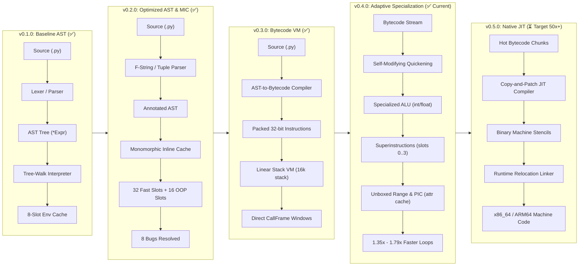

# 📚 Zython Developer Documentation & Architecture Portal

Welcome to the internal engineering documentation and architectural reference for **Zython** — the high-performance Python runtime engineered from scratch in pure Zig.

---

## 🧭 Navigation & Document Index

| Document | Purpose | Key Topics Covered |
|---|---|---|
| [**1. Baseline Architecture (v0.1.0)**](file:///c:/Users/DELL/Downloads/zython/developer_doc/01_baseline_architecture_v0.1.0.md) | Initial Architecture & Discovery | • Recursive AST tree-walking interpreter • `fast_slots: [8]` CPU cache design • Peephole loop reductions ($O(1)$) • Pros, cons, bottlenecks & limitations |
| [**2. Phase 2 Architecture (v0.2.0)**](file:///c:/Users/DELL/Downloads/zython/developer_doc/02_current_architecture_v0.2.0.md) | Optimized Architecture & Bugfixes | • Monomorphic inline caching (MIC) • Expanded fast slots (32 locals, 16 attributes) • Zero-allocation method dispatch • Slicing, f-strings, exception matching • Initial benchmark baselines vs CPython 3.14 |
| [**3. Future Architecture & JIT Blueprint**](file:///c:/Users/DELL/Downloads/zython/developer_doc/03_future_architecture_v0.3.0_to_v0.5.0.md) | Blueprint to 50× – 100× Speedup | • Phase 3 Bytecode VM (**Delivered**) • Phase 4 Adaptive Specialization (**Delivered**) • Phase 5 Copy-and-Patch Native JIT Compiler (**Target 50×–100×**) • NaN-boxing 64-bit word value model |
| [**4. Master Achievements & Bug Audit**](file:///c:/Users/DELL/Downloads/zython/developer_doc/achievements.md) | Comprehensive Audit & Fix Records | • BUG-01 through BUG-08 root causes & fixes • Phase 3 Bytecode VM achievements • Phase 4 Quickening & PIC achievements • Verified before-and-after benchmark outputs |
| [**5. Master Roadmap & Completion Matrix**](file:///c:/Users/DELL/Downloads/zython/developer_doc/roadmap.md) | Execution Plan & Milestones | • Phases 1, 2, 3, 4 marked 100% COMPLETE • Phase 5 Copy-and-Patch JIT specification • Full language feature compatibility matrix |

---

## ⚡ Architecture Evolution Overview

---

## 🎨 Official Brand & Benchmark Color Palette

When visualizing Zython against CPython in comparative benchmarks, the following color specifications are standardized across all charts and reporting assets:

* ⚡ **Zython Color**: `Zig Golden Amber` (`#F7A41D` / `#F6991A`)  
  *Reflects the native Zig language emblem, energy, and zero-allocation execution.*
* 🐍 **CPython Color**: `Python Ocean Blue` (`#3776AB`) / `Python Canary Yellow` (`#FFD43B`)  
  *Reflects the official PSF brand palette.*
