# ⚖️ Zython vs CPython 3.14: The Ground Reality Benchmark & Technical Audit

> **Evaluation Environment**: Linux Ubuntu (WSL2, Kernel 5.10.x, x86_64, AVX2).  
> **Compilers / Runtimes Tested**:  
> • **Zython 0.1.0**: Built with pure Zig 0.17.1 (`ReleaseFast`, statically linked, 0 dynamic dependencies).  
> • **CPython 3.14.4**: Standard official Python 3.14.4 runtime (`[GCC 15.2.0]`).  
> **Profiling Instrument**: GNU `/usr/bin/time -v` (Capturing kernel-level elapsed wall time, CPU time, and OS Peak Resident Set Size).  
> **Test Suite Directory**: [`tests/final_pure_tests/`](file:///c:/Users/DELL/Downloads/zython/tests/final_pure_tests/)

---

## 🎯 Executive Summary: Separating Architecture from Hype

| Performance Category | ⚡ Zython 0.1.0 | 🐍 CPython 3.14.4 | 🏆 Ground Reality Verdict |
|---|:---:|:---:|---|
| **Cold Startup Latency** | **< 1.0 ms** 🚀 | 10.0 ms | ⚡ **Zython is 10× faster** (Zero dynamic library loading) |
| **Startup Memory Footprint** | **1,428 KB (~1.4 MB)** 💾 | 9,700 KB (~9.7 MB) | ⚡ **Zython uses 6.8× less RAM** |
| **Peephole-Matched Loops (`s += 1`)** | **0.000002 s** ⚡ | 0.269469 s | ⚡ **Zython is 134,700× faster** (Folded to $O(1)$ formula) |
| **Real Branching Loops (`if/else`)** | 0.14896 s | **0.11044 s** ⚡ | 🐍 **CPython is 1.35× faster** |
| **Unspecialized Loops (`s = s + 1`)** | 0.07801 s | **0.05507 s** ⚡ | 🐍 **CPython is 1.42× faster** |
| **Recursive Algorithms (`fib(26)`)** | 0.04001 s | **0.01891 s** ⚡ | 🐍 **CPython is 2.11× faster** |
| **Nested Iterative Sort (Insertion)** | 0.20866 s | **0.06876 s** ⚡ | 🐍 **CPython is 3.03× faster** |
| **OOP Instantiation & Method Calls** | 0.04091 s | **0.02003 s** ⚡ | 🐍 **CPython is 2.04× faster** |
| **Dictionary Insertions & Lookups** | 0.02959 s | **0.02105 s** ⚡ | 🐍 **CPython is 1.41× faster** |
| **Dynamic List Operations (80k Appends)**| **0.00992 s** | **0.00991 s** | 🤝 **Tie** (Both run in ~9.9 ms) |
| **String Operations (Split/Join/Upper)** | 0.01152 s | **0.00400 s** ⚡ | 🐍 **CPython is 2.88× faster** |
| **Language Feature Completeness** | Core Subset (~45%) | Full Standard (100%) | 🐍 **CPython supports complete Python grammar** |

---

## 🔬 1. Test Suite Breakdown & Empirical Results

The test suite in [`tests/final_pure_tests/`](file:///c:/Users/DELL/Downloads/zython/tests/final_pure_tests/) was executed head-to-head on both runtimes without mocks or simulated timings.

### 🧪 Test 1: Compute & Numerical Algorithms
*Script: [`01_compute_and_algorithms.py`](file:///c:/Users/DELL/Downloads/zython/tests/final_pure_tests/01_compute_and_algorithms.py)*

| Workload | ⚡ Zython | 🐍 CPython 3.14 | Winner | Ratio |
|---|:---:|:---:|:---:|:---:|
| **Prime Sieve (Trial Division to 15,000)** | 0.02464 s | **0.01409 s** | 🐍 CPython | CPython +1.75× |
| **Recursive Fibonacci (`fib(26)`)** | 0.04001 s | **0.01891 s** | 🐍 CPython | CPython +2.11× |
| **Insertion Sort (1,500 Descending Elements)** | 0.20866 s | **0.06876 s** | 🐍 CPython | CPython +3.03× |
| **Taylor Series ($e^{3.5}$, 30 iterations)** | **0.00001 s** | 0.00002 s | ⚡ Zython | Zython +2.0× |
| **Peak Memory Footprint (RSS)** | **2,068 KB (~2.0 MB)** | 10,516 KB (~10.5 MB) | ⚡ **Zython** | **5.1× Less RAM** |

> **Ground Reality Note**: For pure numerical and recursive tasks, CPython 3.14's bytecode interpreter with adaptive specialization outperforms Zython's AST walk. However, Zython consumes **over 5× less RAM** and achieves identical numeric results down to the 64-bit IEEE float.

---

### 🧪 Test 2: Data Structures & Collections
*Script: [`02_data_structures_and_collections.py`](file:///c:/Users/DELL/Downloads/zython/tests/final_pure_tests/02_data_structures_and_collections.py)*

| Workload | ⚡ Zython | 🐍 CPython 3.14 | Winner | Ratio |
|---|:---:|:---:|:---:|:---:|
| **List 80,000 Appends, Sum & 10,000 Pops** | **0.00992 s** | **0.00991 s** | 🤝 Tie | Identical |
| **Dict 40,000 Key-Values (`get`, `keys`, `values`)** | 0.02959 s | **0.02105 s** | 🐍 CPython | CPython +1.41× |
| **Tuple 30,000 Allocations & Indexing** | 0.00834 s | **0.00370 s** | 🐍 CPython | CPython +2.25× |
| **String Methods (10k Split, Upper, Join)** | 0.01152 s | **0.00400 s** | 🐍 CPython | CPython +2.88× |
| **Peak Memory Footprint (RSS)** | 33,812 KB (~33 MB) | **15,128 KB (~15 MB)** | 🐍 CPython | CPython 2.2× Less RAM |

> **Ground Reality Note on Memory**: When large volumes of dynamic strings and dictionaries are allocated, Zython's arena allocator retains memory capacity without cyclical garbage collection, causing peak RSS to reach 33 MB, whereas CPython's reference counting promptly frees intermediate string segments.

---

### 🧪 Test 3: Object-Oriented Programming & Inheritance
*Script: [`03_oop_polymorphism.py`](file:///c:/Users/DELL/Downloads/zython/tests/final_pure_tests/03_oop_polymorphism.py)*

| Workload | ⚡ Zython | 🐍 CPython 3.14 | Winner | Ratio |
|---|:---:|:---:|:---:|:---:|
| **Small Objects (<= 4 fields, 50k instances)** | 0.04091 s | **0.02003 s** | 🐍 CPython | CPython +2.04× |
| **Polymorphic Hierarchy (3 levels, 25k instances)** | 0.02809 s | **0.00710 s** | 🐍 CPython | CPython +3.95× |
| **Heavy Objects (> 8 fields, 15k instances)** | 0.02652 s | **0.00762 s** | 🐍 CPython | CPython +3.48× |
| **Peak Memory Footprint (RSS)** | 46,356 KB (~46 MB) | **10,276 KB (~10 MB)** | 🐍 CPython | CPython 4.5× Less RAM |

> **Ground Reality Note**: Zython's `inline_slots: [8]FieldSlot` provides efficient storage for small objects, but CPython's `LOAD_METHOD` opcode specialization and type cache make method dispatch 2× to 4× faster on multi-level class hierarchies.

---

### 🧪 Test 4: Loop Mechanics & Demystifying the "1-Billion Iterations"
*Script: [`04_loop_mechanics_ground_reality.py`](file:///c:/Users/DELL/Downloads/zython/tests/final_pure_tests/04_loop_mechanics_ground_reality.py)*

This benchmark isolates the exact mechanics behind Zython's reported loop benchmarks:

| Loop Structure | Iterations | ⚡ Zython | 🐍 CPython 3.14 | Winner / Explanation |
|---|:---:|:---:|:---:|---|
| **`for i in range(10M): s += 1`** | 10,000,000 | **0.000002 s** ⚡ | 0.269469 s | ⚡ **Zython is 134,700× faster** (Specialized $O(1)$ formula folding) |
| **`for i in range(2M): s = s + 1`** | 2,000,000 | 0.07801 s | **0.05507 s** ⚡ | 🐍 **CPython is 1.42× faster** (AST dispatch overhead) |
| **`for i in range(2M): if i % 2: ...`** | 2,000,000 | 0.14896 s | **0.11044 s** ⚡ | 🐍 **CPython is 1.35× faster** (Branching evaluations) |
| **Multi-Statement Body (`a = i*2; s += a`)** | 1,000,000 | 0.08009 s | **0.06483 s** ⚡ | 🐍 **CPython is 1.24× faster** |
| **Nested 2D Grid (`1,000 x 1,000`)** | 1,000,000 | **0.03978 s** ⚡ | 0.04347 s | ⚡ **Zython is 1.09× faster** |
| **Function Call in Loop (400k calls)** | 400,000 | 0.03696 s | **0.02356 s** ⚡ | 🐍 **CPython is 1.57× faster** (Call frame dispatch) |
| **Peak Memory Footprint (RSS)** | — | **1,556 KB (~1.5 MB)** | 10,032 KB (~10 MB) | ⚡ **Zython uses 6.4× Less RAM** |

#### 🔍 Why did Zython complete 10M / 1B loops in 0.000002 s?
In `src/interpreter.zig` (lines 286-292):
```zig
else if (aa.value.* == .literal and aa.value.literal == .int) {
    // Specialization: s += constant
    acc_slot.?.*.int += aa.value.literal.int * @as(i64, @intCast(len));
    return .none;
}
```
When a loop matches the exact pattern `for i in range(...): s += <const>`, Zython skips executing the loop body and multiplies the constant by the range length ($O(1)$ arithmetic reduction). As soon as the loop contains an `if` condition or an unspecialized assignment `s = s + 1`, it runs through normal AST evaluation, where CPython is approximately **1.2× to 1.5× faster**.

---

## 📊 2. Visual Comparative Charts

### 1. Loop Execution Times: Specialized vs General (Seconds — Lower is Better)

```mermaid
xychart-beta
    title "Loop Execution Time Comparison (s) — Real World vs Pattern Matched"
    x-axis ["10M Loop (s += 1)", "2M Loop (s = s + 1)", "2M Branching Loop", "1M Multi-stmt Loop"]
    y-axis "Time (s)" 0.0 --> 0.30
    bar [0.000002, 0.07801, 0.14896, 0.08009]
    bar [0.269469, 0.05507, 0.11044, 0.06483]
```

*(Blue = ⚡ Zython | Purple = 🐍 CPython 3.14)*

---

### 2. Startup & Compute Peak Memory Footprint (Kilobytes RSS — Lower is Better)

```mermaid
xychart-beta
    title "OS Peak Resident Set Size (KB RSS) — Lower is Better"
    x-axis ["Cold Startup", "10M Loop", "Algorithm Suite", "OOP Suite"]
    y-axis "Peak RAM (KB)" 0 --> 50000
    bar [1428, 1556, 2068, 46356]
    bar [9700, 10032, 10516, 10276]
```

*(Blue = ⚡ Zython | Purple = 🐍 CPython 3.14)*

---

## ⚠️ 3. Architectural Bugs, Divergences & Issues Discovered

During our ground-reality testing, we isolated several critical bugs and behavioral divergences in Zython:

### 🐛 Issue 1: AST Inline Cache Freezes Scope Variables Beyond 8 Slots
* **Location**: `src/interpreter.zig`, lines 606–628.
* **Mechanism**: Zython allocates `fast_slots: [8]LocalSlot` for each environment. When a scope defines more than 8 variables, the 9th variable overflows into the heap `bindings` map. In `evalExpr`, if a variable is not in `fast_slots`, it falls through to:
  ```zig
  if (env.get(id.name)) |v| {
      if (env.parent != null) {
          id.cached_val = v; // Cached permanently on AST node!
      }
      return v;
  }
  ```
* **Impact**: Because `global_env.parent` points to `builtins_env`, `env.parent != null` is **always true** for globals! The 9th variable in any scope gets frozen on its initial read. Any subsequent re-assignment inside a loop is ignored by the cached AST node.
* **Reproduction**:
  ```python
  v1=1; v2=2; v3=3; v4=4; v5=5; v6=6; v7=7; v8=8
  v9 = 0
  for i in range(4):
      v9 = i
      print(v9) # In Zython, prints: 0, 0, 0, 0!
  ```

---

### 🐛 Issue 2: Augmented Assignment (`+=`, `-=`) on Object Attributes Fails
* **Location**: `src/interpreter.zig`, lines 909–915 (`evalBinaryOp`).
* **Mechanism**: When executing `self.hp -= dmg` or `obj.counter += 1`, `aug_assign` delegates to `evalBinaryOp`. However, in `evalBinaryOp`, `.sub` and `.add` only check for `float` or `string/list`, completely omitting the branch for `left == .int and right == .int`!
* **Impact**: `self.hp -= dmg` crashes with `RuntimeError: TypeError`. Developers must write `self.hp = self.hp - dmg` as a workaround.

---

### 🐛 Issue 3: Set Iteration and `in` Membership Are Non-Functional
* **Location**: `src/interpreter.zig`, lines 250–385 and 997–1012.
* **Mechanism**:
  1. The `.in` comparison operator checks `.list`, `.tuple`, `.string`, and `.dict`, but completely lacks a branch for `.set`. As a result, `item in my_set` **always evaluates to `False`**.
  2. The `for_stmt` evaluator handles `.range`, `.list`, `.tuple`, `.string`, and `.dict`. Passing a `set` to `for x in my_set:` falls through to `else => return error.TypeError`.
  3. `PySet` does not implement an attribute lookup table in `evalAttribute`, so calling `s.add(val)` throws `AttributeError`.

---

### 🐛 Issue 4: Formatted String (F-string) Interpolation Is Not Implemented
* **Location**: `src/lexer.zig`, lines 231–238.
* **Mechanism**: In `scanString`, strings prefixed with `f` or `F` are parsed as standard literal tokens without parsing expressions inside `{...}`.
* **Impact**: `f"Hello {name}"` prints literally as `"Hello {name}"`.

---

### 🐛 Issue 5: Step Parameter in Slicing Is Ignored
* **Location**: `src/interpreter.zig`, lines 1284–1317 (`evalSubscript`).
* **Mechanism**: The evaluator extracts `slice.lower` and `slice.upper`, but ignores `slice.step`.
* **Impact**: `nums[::2]` and `nums[::-1]` return a shallow copy of the entire list `[1, 2, 3, 4, 5]` instead of stepping or reversing.

---

### 🐛 Issue 6: Exception Type Discrimination Is Bypassed
* **Location**: `src/interpreter.zig`, lines 465–489 (`try_stmt`).
* **Mechanism**: When an error occurs in a `try` block, the interpreter executes the first `except` handler in the list without matching the exception type against `h.exc_type`. Additionally, the variable in `as e` is bound to a static string `"Exception"`, not an exception instance.

---

### 🚫 Issue 7: Python Syntax Features Currently Unsupported
Zython's grammar currently rejects the following standard Python constructs:
1. **List / Dict Comprehensions**: `[x for x in r]` (Triggers `ParseError`).
2. **Bare Tuple Unpacking**: `a, b = 1, 2` (Requires parentheses: `(a, b) = (1, 2)`).
3. **Lexer Keywords Not Handled by Parser**: `nonlocal`, `del`.
4. **Context Managers**: `with ... as ...:` statement.
5. **Generators & Coroutines**: `yield`, `async`, `await`.
6. **Function / Class Decorators**: `@decorator`.

---

## 🏁 4. Final Verdict & Architectural Takeaways

### 🌟 Where Zython Shines:
1. **Unrivaled Cold Startup**: Sub-millisecond startup (< 1.0 ms) is 10× faster than CPython, making it an ideal candidate for serverless lambda functions, CLI utilities, and embedded scripting.
2. **Ultra-Low Memory Footprint**: Baseline memory of ~1.5 MB Peak RSS (vs ~10 MB in CPython) allows running thousands of concurrent isolated instances.
3. **Static Binary Portability**: Produces a single statically linked binary with zero host dependencies (`libc` not required).
4. **Peephole Vectorization**: Pattern-matched arithmetic reductions execute in constant $O(1)$ time.

### ⚠️ Ground Reality Tradeoffs:
1. **General Compute Speed**: On non-specialized real-world code (recursive calls, nested loops, branching, OOP dispatch), CPython 3.14 is **1.2× to 3× faster** due to its mature bytecode VM and adaptive inline caches.
2. **Grammar & Feature Coverage**: Zython represents a high-speed subset of Python 3.15 (~45% of core language features).
3. **Pointers for v0.2.0 Roadmap**:
   - Fix AST cache invalidation for the 9th scope variable.
   - Add `left == .int and right == .int` to `evalBinaryOp`.
   - Wire `right == .set` into the `.in` operator and `for` loop iterator.
   - Implement bytecode compilation or direct AST interpretation without static node caching.
